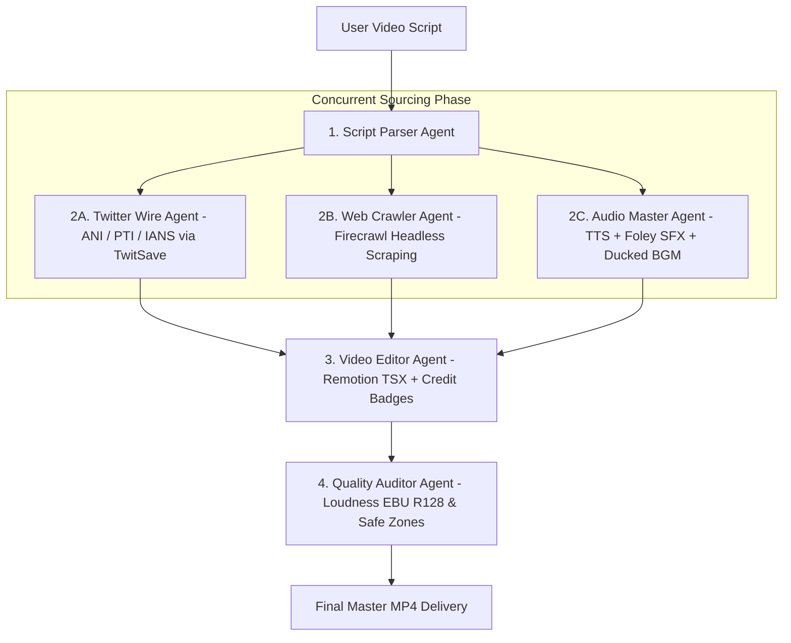

# 🎬 AI Video Production Suite & Antigravity Skills

An end-to-end autonomous multi-agent video production, editing, and motion design ecosystem for **Google Antigravity**, **Claude Code**, **Cursor**, and AI agents.

This suite includes **64 specialized production skills**, autonomous pipeline orchestrators, strict wire agency event video sourcing (ANI, PTI, IANS) via TwitSave automation, Firecrawl web crawling, Remotion React video synthesis, and broadcast QA auditing.

---

## ⚡ Key Highlights

- **64 Production Skills:** Complete workflows covering motion design, 3D product films, kinetic typography, anime, Remotion, Blender, Manim, and social video editing.
- **Autonomous Multi-Agent Pipeline:** Concurrent execution across Script Parsing, Twitter Wire sourcing, Firecrawl web crawling, Audio synthesis, Remotion video compilation, and Quality Auditing.
- **Strict Wire Agency Event Policy:** Automated Twitter clip acquisition exclusively whitelisted to **ANI** (`@ANI`), **PTI** (`@PTI_News`), and **IANS** (`@IANS_India`), with mandatory on-screen credit badges (`Clip Source: ANI`).
- **TwitSave Automated Fetcher:** Headless pipeline to extract MP4 video assets from Twitter wire agency posts at 1080p/720p with target aspect ratios (9:16 vertical or 16:9 horizontal).
- **Remotion Video Core:** Programmatic React video rendering with mobile-safe zone layout, audio ducking (-14 LUFS), and motion overlay graphics.

---

## 🗂️ Repository Architecture

```text
ai-video-production-suite/
├── plugin.json                 # Antigravity plugin manifest
├── mcp_config.json             # MCP server configuration (Twitter, Firecrawl)
├── .gitignore                  # Clean git boundaries
├── rules/
│   └── AGENTS.md               # Strict workspace & agency sourcing rules
├── scripts/
│   ├── auto_fetch_twitter_clip.py    # Automated TwitSave fetcher & processor
│   ├── download_twitter_clip.py      # Twitter clip extraction utility
│   └── multi_agent_video_pipeline.py # Autonomous orchestrator
└── skills/                     # 64 Specialized AI Video Production Skills
    ├── director/               # End-to-end project director & storyboarder
    ├── edit/                   # Master editing router
    ├── multi-agent-director/   # Full autonomous multi-agent pipeline
    ├── twitter-video-fetcher/  # TwitSave wire agency downloader
    ├── auto-cut-editor/        # Silence & mistake cutting via local Whisper/VAD
    ├── ai-video-editor/        # Talking head editor with 3D motion graphics
    ├── reels/                  # 9:16 Vertical Reel/Short/TikTok editor
    ├── youtube/                # 16:9 Horizontal YouTube & documentary editor
    ├── vox-director/           # Vox-style investigative documentary editing
    ├── saas/                   # SaaS product promo & 3D tilt dashboard animations
    ├── blender-product-film/   # Headless Blender 3D photoreal product videos
    ├── blender-video-tools/    # Blender Python (bpy) VSE scripting
    ├── manim-motion-graphics/  # Programmatic math & tech visual sequences
    ├── threejs-animation/      # WebGL & 3D hero animations
    ├── particle-system/        # GPU particle emitters & physics
    ├── shader-glsl/            # Custom GLSL fragment shaders & displacement
    ├── remotion-*/             # 14 specialized Remotion framework skills
    ├── video-analyzer-qa/      # Broadcast EBU R128 loudness & safe zone QA
    └── ... (64 skills total)
```

---

## 🤖 Autonomous Multi-Agent Pipeline Protocol

When a script (e.g. for a news or social event) is provided, the autonomous pipeline coordinates across specialized agents:



### 1. Event Footage Policy (Strict Whitelist)
- **Platform:** Twitter/X ONLY. (Never use YouTube for event/news reporting footage).
- **Authorized Sources:**
  - **ANI** (`@ANI`)
  - **PTI** (`@PTI_News`)
  - **IANS** (`@IANS_India` / `@ians_news`)
- **Mandatory On-Screen Attribution:** `Clip Source: ANI`, `Clip Source: PTI`, or `Clip Source: IANS`.
- **YouTube Scope:** Strictly restricted to non-event creative assets (BGM, sound effects, green screen keyed FX, abstract stock footage).

---

## 🚀 Installation & Setup

### Option 1: Google Antigravity Plugin
Clone or copy this repository into your Antigravity plugin directory:
```powershell
# Windows Antigravity Plugin Path
cd $env:USERPROFILE\.gemini\config\plugins
git clone https://github.com/y-jadhav/ai-video-production-suite.git
```

Enable the plugin in Antigravity:
```text
/plugin enable ai-video-production-suite
```

### Option 2: Standalone Workspace Usage
Clone directly into any local video editing workspace:
```bash
git clone https://github.com/y-jadhav/ai-video-production-suite.git
cd ai-video-production-suite
```

Install Python & Node dependencies:
```bash
pip install requests beautifulsoup4
npm install
```

---

## 🛠️ Automated Twitter Wire Sourcing Example

Fetch a verified wire clip with automatic aspect ratio cropping and 30fps normalization:

```powershell
# Fetch specific tweet from ANI
python scripts/auto_fetch_twitter_clip.py --url "https://twitter.com/ANI/status/..." --source "ANI" --output-dir "public/cjp_protest_assets" --aspect 9:16 --fps 30

# Search and fetch clips for an event across authorized agencies
python scripts/auto_fetch_twitter_clip.py --query "protest demonstration" --agency ANI --output-dir "public/cjp_protest_assets"
```

---

## 📦 Skills Catalog (64 Skills)

| Category | Skills |
| :--- | :--- |
| **Director & Editing** | `director`, `edit`, `multi-agent-director`, `auto-cut-editor`, `ai-video-editor`, `reels`, `youtube`, `vox-director`, `saas`, `faceless-explainer`, `faceless-shorts`, `talking-head-recut`, `video-clone` |
| **Asset Sourcing & Intelligence** | `twitter-video-fetcher`, `auto_fetch_twitter_clip`, `multi_agent_video_pipeline` |
| **Remotion Suite (React Video)** | `remotion-best-practices`, `remotion-create`, `remotion-render`, `remotion-studio`, `remotion-captions`, `remotion-markup`, `remotion-multimedia`, `remotion-maps`, `remotion-interactivity`, `remotion-saas`, `remotion-upgrade`, `remotion-license`, `remotion-docs`, `remotion-to-hyperframes` |
| **3D & Creative Animation** | `blender-product-film`, `blender-video-tools`, `manim-motion-graphics`, `threejs-animation`, `particle-system`, `shader-glsl`, `camera-arc`, `anime-cel`, `crayon-storybook`, `painted-animation`, `paper-cutout`, `pixel-art`, `whiteboard` |
| **Motion Design & Overlays** | `fx`, `motion-graphics`, `motion-overlays`, `motion-doctrine`, `oversized-cursor`, `captions-overlay`, `embedded-captions`, `seam-craft`, `cut-the-curve`, `video-shotcraft`, `theme`, `slideshow`, `figma`, `frontend-design` |
| **Audio, Rendering & QA** | `sound`, `ffmpeg`, `music-to-video`, `qa`, `video-analyzer-qa` |

---

## 📄 License

MIT License. Designed for AI video creators, editors, and autonomous agent swarms.
