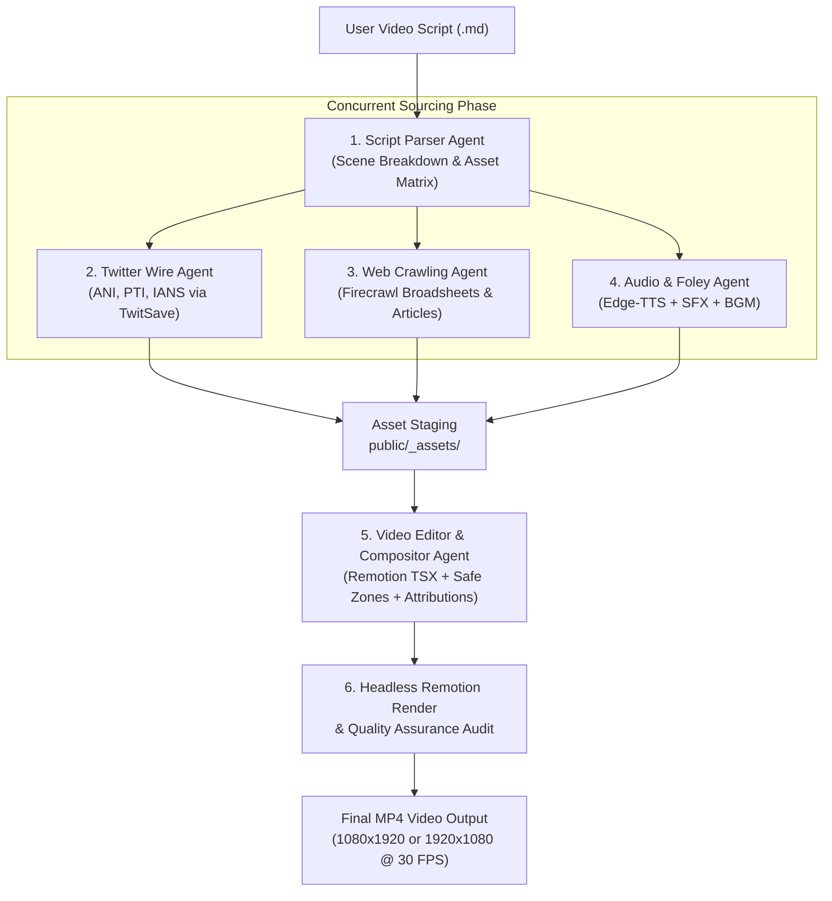

# 🤖 Multi-Agent Autonomous Video Production Pipeline

This skill orchestrates a team of specialized AI agents working together from a single script to deliver a finished, fully edited, broadcast-ready video.



---

## 👥 The 5 Agent Roles

### 1. 📝 Script Parser Agent
- **Input:** Video script markdown (e.g. `script.md`).
- **Function:** Breaks down the script into scene timing blocks, voiceover text, and visual requirements.
- **Output:** Structured asset requirement matrix identifying which scenes require event clips, newspaper clippings, or sound effects.

### 2. 🐦 Twitter Wire Agency Agent
- **Function:** Sourcing authentic event, protest, and political footage.
- **Strict Rule:** Sources **exclusively** from verified wire services: **ANI** (`@ANI`), **PTI** (`@PTI_News`), **IANS** (`@IANS_India` / `@ians_news`).
- **Engine:** Automated **TwitSave (`https://twitsave.com/en`)** pipeline.
- **Output:** Standardized MP4 clips (`9:16` or `16:9` @ 30 FPS) with mandatory on-screen credit: `"Clip Source: ANI"`.

### 3. 🕷️ Web Crawling & Research Agent
- **Function:** Sourcing verified articles, headlines, press releases, and legal notices.
- **Engine:** **Firecrawl MCP** (`firecrawl_scrape`, `firecrawl_search`).
- **Output:** Authentic broadsheet newspaper graphics (The Hindu, TOI), official notices, and highlighted evidence cards.

### 4. 🎵 Audio & Foley Sound Agent
- **Function:** Dialogue and soundscape engineering.
- **Engine:** Local `edge-tts` (fast, expressive narration) + tactile Foley audio libraries.
- **Output:** Synced master audio track (-14 to -16 LUFS) with paper slides, marker writing, rubber stamp slams, and ducked musical beds.

### 5. 🎬 Video Editor & Compositor Agent
- **Function:** Visual compilation and final render.
- **Engine:** Remotion / React.
- **Enforcements:**
  - Mobile safe zones (top 12% `y < 230px`, bottom 16% `y > 1620px`).
  - Tactile Vox styling: `#F3EFE6` warm paper ground, yellow highlighter sweeps, red rubber stamps.
  - Automatic frame extraction for visual QA.

---

## ⚡ Execution Command

To execute the autonomous pipeline:
```powershell
python multi_agent_video_pipeline.py --script "<path_to_script.md>" --project-name "<project_name>" --aspect "9:16|16:9"
```
